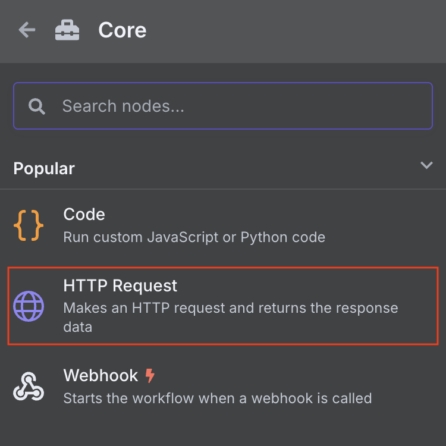
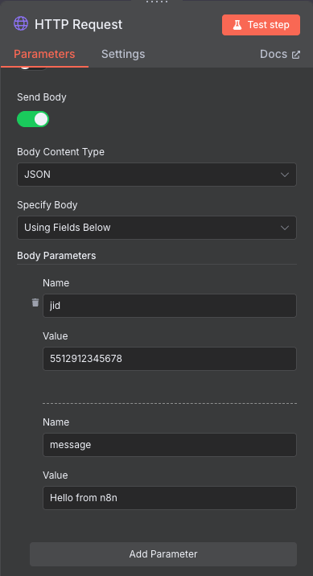

## Description

n8n is a workflow automation tool. There are two ways to use ZapperHub in n8n:

| Way | When to use |
|---|---|
| **ZapperHub node** (`n8n-nodes-zapperhub` package) | Recommended. The fields are guided, and the **ZapperHub Trigger** receives the events with no configuration in the panel. |
| **HTTP Request node** (native to n8n) | When your n8n does not install community packages. You fill in the URL, the method, and the body manually. |

The package has two nodes:

- **ZapperHub**: sends messages and runs the other API operations.
- **ZapperHub Trigger**: starts the workflow when an event occurs in the instance.

## Preliminary requirements

- The id and the API key of the instance. See [Quickstart](/en/quickstart).
- To install the package: a user with permission to install community nodes in
  n8n.
- For the **ZapperHub Trigger**: n8n reachable from the internet over HTTPS.
  ZapperHub sends events only to HTTPS URLs.

<Note>
n8n Cloud installs only the community packages that n8n verified. If your n8n
does not find the package, use the [HTTP Request node](#http-request-node).
</Note>

## Install the package

<Steps>
  <Step title="Open the community nodes">
    In n8n, open **Settings**, then **Community nodes**.
  </Step>
  <Step title="Install">
    Click **Install**. In **npm Package Name**, type `n8n-nodes-zapperhub`.
    Check the risk confirmation and click **Install**.
  </Step>
</Steps>

## Create the credential

<Steps>
  <Step title="Add the node">
    In the workflow, add a node and search for **ZapperHub**.
  </Step>
  <Step title="Create the credential">
    In **Credential to connect with**, select **Create new credential**. Fill in
    **Instance ID** and **API Key** with the data of the instance. Click
    **Save**.
  </Step>
</Steps>

n8n tests the credential with `GET /{instanceId}/connection`. One credential is
for one instance. To use another instance, create another credential.

## Send a message

<Steps>
  <Step title="Select the operation">
    In the **ZapperHub** node, select **Resource** `Message` and **Operation**
    `Send Text`.
  </Step>
  <Step title="Fill in the fields">
    In **Recipient**, type the number with the country code, with no `+`,
    spaces, or dashes. In **Text**, type the message.
  </Step>
  <Step title="Test">
    Click **Execute step**.
  </Step>
</Steps>

The API responds with `status: "scheduled"`, and the message enters the
[queue](/en/definitions/queue) of the instance. The messages that the node sends
have `trackSource: "n8n"`, in the [Message log](/en/panel/message-log) and in
the webhooks.

Media, audio, and sticker accept three sources in **File Source**: a URL, a
base64 file, or a binary file from a previous node (**Binary File**).

## Receive events

<Steps>
  <Step title="Add the trigger">
    Add the **ZapperHub Trigger** node and select the credential of the
    instance.
  </Step>
  <Step title="Select the events">
    In **Events**, select the events. For received messages, select
    **Message Received or Sent**.
  </Step>
  <Step title="Activate the workflow">
    Publish the workflow, or click to listen for a test event.
  </Step>
</Steps>

On activation, the node registers a webhook in the instance, with the name
`n8n:` followed by the workflow name. The webhook shows in
[Webhooks](/en/panel/webhooks), in the panel. When you deactivate the workflow,
the node removes the webhook.

- The node checks the `x-webhook-signature` signature of each event. An event
  with no valid signature gets `401` and does not start the workflow. See
  [Request authenticity](/en/integrations/webhooks#request-authenticity).
- **Ignore Messages Sent by Me** is on by default. Thus, the reply that the
  workflow sends does not start the workflow again.
- In **Options**, **Ignore Group Messages** ignores the messages from groups.

<Warning>
On the official connection, the **Call Update** event (`calls.update`) turns on
calls for the number at Meta. If the number cannot receive calls, ZapperHub
refuses the webhook. n8n shows the error, and the workflow is not published.
Remove **Call Update** from **Events** and publish the workflow again. See
[Call](/en/integrations/webhooks#call).
</Warning>

## Resources and operations

| Resource | Operations |
|---|---|
| Message | Send text, media, audio, sticker, location, contact, buttons, list, carousel, template, PIX charge, and text as voice; react; mark as read; delete; get many; delivery receipts; 24-hour window |
| Call | Make, play audio, hang up, reject, get, get many, get and request call permission |
| Chat | Archive, unarchive, mute, pin, delete |
| Contact | Check numbers, get, profile picture, phone number from LID, block, unblock, blocked, marketing opt-outs, marketing preference, delete data |
| Group | Get, get many, update participants |
| Template | Get, get many, sync with Meta, sync status |
| Instagram | Reply privately to a comment, comment on a post, get post, get many posts |
| Channel | Get many channels |
| Profile | Update picture, remove picture, update about |
| Connection | Get the connection, the QR Code, or the pairing code |

The **ZapperHub** node also works as a tool of the n8n **AI Agent**.

## HTTP Request node

<Steps>
  <Step title="Add the HTTP Request node">
    Click to add a node. In the side menu, select **Core**, then **HTTP Request**.

    
  </Step>
  <Step title="Set the method">
    In **Method**, select the method of the route. To send a message, select `POST`.
  </Step>
  <Step title="Enter the URL">
    In **URL**, type the complete URL of the route. Example, to send a text message:
    `https://api.zapperhub.com/inst_abcdefg123456/messages/text`.
  </Step>
  <Step title="Configure the authentication">
    In **Authentication**, select **Generic Credential Type**. Then select **Header Auth**.
  </Step>
  <Step title="Create the credential">
    In **Header Auth**, click **Create new credential**. Click the window title
    and rename the credential to `ZapperHub Auth`. Fill in **Name** with
    `X-Api-Key` and **Value** with the API key of the instance. Click **Save** and
    close the window.
  </Step>
  <Step title="Fill in the body">
    Check **Send Body**. In **Body Parameters**, fill in **Name** and **Value**
    with the fields of the route. For a text message, enter `jid` and `message`.

    
  </Step>
  <Step title="Test">
    Close the node window and click **Execute workflow**.
  </Step>
</Steps>

The API responds `200` with `status: "scheduled"`. The message enters the
instance queue.

To receive events without the package, use the n8n **Webhook** node and
register its production URL in [Webhooks](/en/panel/webhooks).

<Note>
Format the phone number with no parentheses, spaces, or dashes. See
[Number format](/en/definitions/number-format).
</Note>

## Migrate from n8n-nodes-zapperapi

The `n8n-nodes-zapperapi` package is the previous package. It calls the
`api.zapperapi.com` domain, which responds until **June 30, 2027**. See
[API domain](/en/definitions/api-domain).

The two packages can be installed at the same time. Change one workflow at a
time.

<Steps>
  <Step title="Install the new package">
    Install `n8n-nodes-zapperhub`. See [Install the package](#install-the-package).
  </Step>
  <Step title="Create the new credential">
    Create the **ZapperHub API** credential with the same id and the same key of
    the instance.
  </Step>
  <Step title="Replace the nodes">
    In each workflow, replace the **ZapperAPI** node with the **ZapperHub** node,
    with the same operation, and fill in the fields again. The **JID** field is
    now named **Recipient**. In the text send, the **Message** field is now
    named **Text**.
  </Step>
  <Step title="Replace the Webhook node, if the workflow uses one">
    If the workflow receives events through the n8n **Webhook** node, you can
    replace it with the **ZapperHub Trigger**. Then delete the old webhook in
    [Webhooks](/en/panel/webhooks).
  </Step>
  <Step title="Test and uninstall">
    Test each workflow. Then uninstall `n8n-nodes-zapperapi` in **Settings** >
    **Community nodes**.
  </Step>
</Steps>

<Warning>
If you replace the **Webhook** node with the **ZapperHub Trigger** and do not
delete the old webhook, each event arrives twice in n8n.
</Warning>

The new package does not have the operations to create a group, update a group,
get the invite code, and change the profile name. The API does not have these
routes.

## See also

- [Webhooks](/en/integrations/webhooks)
- [API domain](/en/definitions/api-domain)
- [Number format](/en/definitions/number-format)
