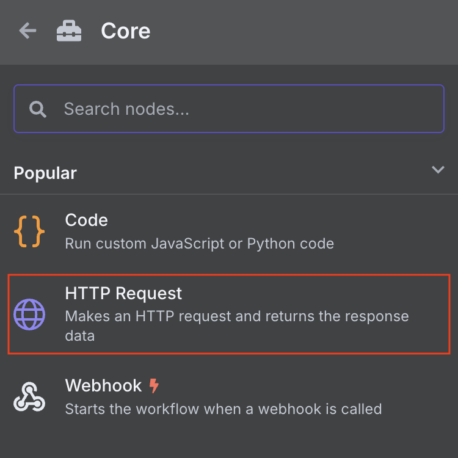
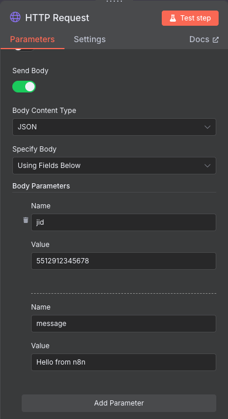

## Descrição

O n8n é uma ferramenta de automação de fluxos. Há duas formas de usar a
ZapperHub no n8n:

| Forma | Quando usar |
|---|---|
| **Nó da ZapperHub** (pacote `n8n-nodes-zapperhub`) | Recomendada. Os campos são guiados, e o gatilho **ZapperHub Trigger** recebe os eventos sem configuração no painel. |
| **Nó HTTP Request** (nativo do n8n) | Quando o seu n8n não instala pacotes da comunidade. Exige o preenchimento manual da URL, do método e do corpo. |

O pacote tem dois nós:

- **ZapperHub**: envia mensagens e executa as outras operações da API.
- **ZapperHub Trigger**: inicia o fluxo quando um evento acontece na instância.

## Pré-requisitos

- O id e a chave de API da instância. Veja [Início rápido](/quickstart).
- Para instalar o pacote: um usuário com permissão para instalar nós da
  comunidade no n8n.
- Para o **ZapperHub Trigger**: o n8n acessível pela internet em HTTPS. A
  ZapperHub só envia eventos para URLs HTTPS.

<Note>
O n8n Cloud instala só os pacotes da comunidade verificados pelo n8n. Se o seu
n8n não encontra o pacote, use o [nó HTTP Request](#no-http-request).
</Note>

## Instalar o pacote

<Steps>
  <Step title="Abra os nós da comunidade">
    No n8n, abra **Settings** e depois **Community nodes**.
  </Step>
  <Step title="Instale">
    Clique em **Install**. Em **npm Package Name**, digite
    `n8n-nodes-zapperhub`. Marque a confirmação de risco e clique em
    **Install**.
  </Step>
</Steps>

## Criar a credencial

<Steps>
  <Step title="Adicione o nó">
    No fluxo, adicione um nó e procure **ZapperHub**.
  </Step>
  <Step title="Crie a credencial">
    Em **Credential to connect with**, selecione **Create new credential**.
    Preencha **Instance ID** e **API Key** com os dados da instância. Clique em
    **Save**.
  </Step>
</Steps>

O n8n testa a credencial com `GET /{instanceId}/connection`. Uma credencial vale
para uma instância. Para usar outra instância, crie outra credencial.

## Enviar uma mensagem

<Steps>
  <Step title="Escolha a operação">
    No nó **ZapperHub**, selecione **Resource** `Message` e **Operation**
    `Send Text`.
  </Step>
  <Step title="Preencha os campos">
    Em **Recipient**, digite o número com o código do país, sem `+`, espaços ou
    traços. Em **Text**, digite a mensagem.
  </Step>
  <Step title="Teste">
    Clique em **Execute step**.
  </Step>
</Steps>

A API responde com `status: "scheduled"`, e a mensagem entra na
[fila](/definitions/queue) da instância. As mensagens enviadas pelo nó levam
`trackSource: "n8n"`, no [Log de mensagens](/painel/log-de-mensagens) e nos
webhooks.

Mídia, áudio e figurinha aceitam três origens em **File Source**: uma URL, um
arquivo em base64 ou um arquivo binário de um nó anterior (**Binary File**).

## Receber eventos

<Steps>
  <Step title="Adicione o gatilho">
    Adicione o nó **ZapperHub Trigger** e selecione a credencial da instância.
  </Step>
  <Step title="Escolha os eventos">
    Em **Events**, selecione os eventos. Para mensagens recebidas, selecione
    **Message Received or Sent**.
  </Step>
  <Step title="Ative o fluxo">
    Publique o fluxo, ou clique para ouvir um evento de teste.
  </Step>
</Steps>

Ao ativar, o nó cadastra um webhook na instância, com o nome `n8n:` seguido do
nome do fluxo. O webhook aparece em [Webhooks](/painel/webhooks), no painel. Ao
desativar o fluxo, o nó remove o webhook.

- O nó confere a assinatura `x-webhook-signature` de cada evento. Um evento sem
  assinatura válida recebe `401` e não inicia o fluxo. Veja
  [Autenticidade das requisições](/integrations/webhooks#autenticidade-das-requisicoes).
- **Ignore Messages Sent by Me** fica ligado por padrão. Assim, a resposta que
  o próprio fluxo envia não inicia o fluxo outra vez.
- Em **Options**, **Ignore Group Messages** ignora as mensagens de grupos.

<Warning>
Em conexão oficial, o evento **Call Update** (`calls.update`) habilita as
chamadas do número na Meta. Se o número não pode receber chamadas, a ZapperHub
recusa o webhook. Veja [Eventos disponíveis](/integrations/webhooks#eventos-disponiveis).
</Warning>

## Recursos e operações

| Recurso | Operações |
|---|---|
| Message | Enviar texto, mídia, áudio, figurinha, localização, contato, botões, lista, carrossel, template, cobrança PIX e texto como voz; reagir; marcar como lida; apagar; listar; recibos de entrega; janela de 24 horas |
| Call | Ligar, tocar áudio, desligar, recusar, consultar, listar, consultar e pedir permissão de ligação |
| Chat | Arquivar, desarquivar, silenciar, fixar, apagar |
| Contact | Checar números, consultar, foto do perfil, número a partir do LID, bloquear, desbloquear, bloqueados, opt-out de marketing, preferência de marketing, apagar os dados |
| Group | Consultar, listar, alterar participantes |
| Template | Consultar, listar, sincronizar com a Meta, estado da sincronização |
| Instagram | Responder no privado a um comentário, comentar em um post, consultar post, listar posts |
| Channel | Listar canais |
| Profile | Alterar foto, remover foto, alterar recado |
| Connection | Consultar a conexão, o QR Code ou o código de pareamento |

O nó **ZapperHub** também funciona como ferramenta do **AI Agent** do n8n.

## Nó HTTP Request

<Steps>
  <Step title="Adicione o nó HTTP Request">
    Clique em adicionar um nó. No menu lateral, selecione **Core** e depois **HTTP Request**.

    
  </Step>
  <Step title="Defina o método">
    Em **Method**, selecione o método da rota. Para enviar mensagem, selecione `POST`.
  </Step>
  <Step title="Informe a URL">
    Em **URL**, digite a URL completa da rota. Exemplo, para enviar uma mensagem de texto:
    `https://api.zapperhub.com/inst_abcdefg123456/messages/text`.
  </Step>
  <Step title="Configure a autenticação">
    Em **Authentication**, selecione **Generic Credential Type**. Em seguida, selecione **Header Auth**.
  </Step>
  <Step title="Crie a credencial">
    Em **Header Auth**, clique em **Create new credential**. Clique no título da
    janela e renomeie a credencial para `ZapperHub Auth`. Preencha **Name** com
    `X-Api-Key` e **Value** com a chave de API da instância. Clique em **Save** e
    feche a janela.
  </Step>
  <Step title="Preencha o corpo">
    Marque **Send Body**. Em **Body Parameters**, preencha **Name** e **Value**
    com os campos da rota. Para uma mensagem de texto, informe `jid` e `message`.

    
  </Step>
  <Step title="Teste">
    Feche a janela do nó e clique em **Test Workflow**.
  </Step>
</Steps>

A API responde `200` com `status: "scheduled"`. A mensagem entra na fila da
instância.

Para receber eventos sem o pacote, use o nó **Webhook** do n8n e cadastre a URL
de produção dele em [Webhooks](/painel/webhooks).

<Note>
Formate o número de telefone sem parênteses, espaços ou traços. Veja
[Formato do número](/definitions/number-format).
</Note>

## Migrar do n8n-nodes-zapperapi

O pacote `n8n-nodes-zapperapi` é o pacote anterior, que chama o domínio `api.zapperapi.com`, e que atende até
**30 de junho de 2027**. Veja [Domínio da API](/definitions/dominio-da-api).

Os dois pacotes podem ficar instalados juntos. Troque um fluxo de cada vez.

<Steps>
  <Step title="Instale o pacote novo">
    Instale `n8n-nodes-zapperhub`. Veja [Instalar o pacote](#instalar-o-pacote).
  </Step>
  <Step title="Crie a credencial nova">
    Crie a credencial **ZapperHub API** com o mesmo id e a mesma chave da
    instância.
  </Step>
  <Step title="Troque os nós">
    Em cada fluxo, troque o nó **ZapperAPI** pelo nó **ZapperHub**, com a mesma
    operação, e preencha os campos outra vez. O campo **JID** agora se chama
    **Recipient**.
  </Step>
  <Step title="Troque o webhook, se usar o gatilho">
    Se o fluxo recebe eventos pelo nó **Webhook** do n8n, você pode trocá-lo
    pelo **ZapperHub Trigger**. Depois, apague o webhook antigo em
    [Webhooks](/painel/webhooks).
  </Step>
  <Step title="Teste e desinstale">
    Teste cada fluxo. Depois, desinstale `n8n-nodes-zapperapi` em
    **Settings** > **Community nodes**.
  </Step>
</Steps>

<Warning>
Se você trocar o nó **Webhook** pelo **ZapperHub Trigger** e não apagar o
webhook antigo, cada evento chega duas vezes ao n8n.
</Warning>

O pacote novo não tem as operações de criar grupo, alterar grupo, código de
convite e nome do perfil. A API não tem essas rotas.

## Veja também

- [Webhooks](/integrations/webhooks)
- [Domínio da API](/definitions/dominio-da-api)
- [Formato do número](/definitions/number-format)
